<p align="center">
  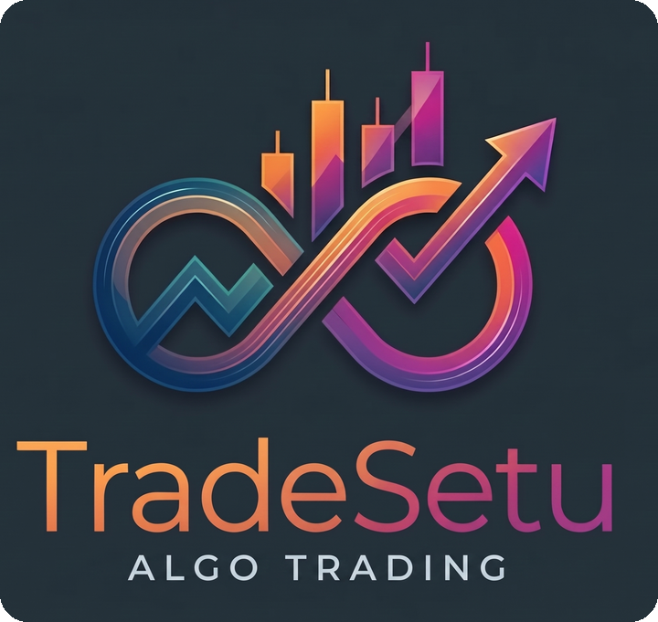
</p>

<h1 align="center">TradeSetu</h1>

<p align="center">
  <b>An open-source trading desk built for Indian traders.</b><br>
  NSE · BSE · F&amp;O · MCX. Charts, strategy backtests, paper trading and algos on Zerodha Kite.
</p>

<p align="center">
  <a href="LICENSE"></a>
  
  
  
</p>

> [!WARNING]
> **Not investment advice. The authors are not registered with SEBI** as investment advisers, research analysts or algo providers. TradeSetu is software, not a recommendation to buy or sell anything. Strategies you run on your own broker API keys are your responsibility. Read the [disclaimer](#disclaimer) before trading live.

<p align="center">
  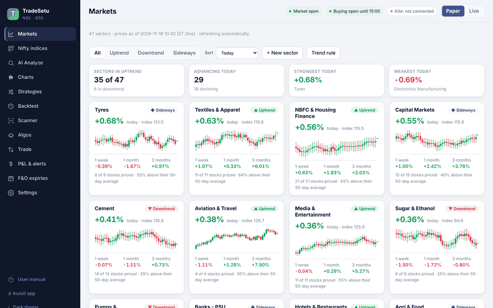
</p>

## Who this is for

TradeSetu is made for **traders and investors in India**. It speaks the Indian market's language: NSE and BSE symbols (`RELIANCE`, `NSE:INFY`, `BSE:500325`), Nifty and Sensex indices, weekly F&amp;O expiries, MCX gold and silver, IST market hours, exchange holidays, and Zerodha's charges, including STT, exchange fees, stamp duty and GST. Live trading goes through **Zerodha Kite Connect**.

If you trade outside India, this is not the tool for you. Symbols resolve to Indian listings by default.

## Features

| | |
|---|---|
| **Markets at a glance**<br>47 sector cards with trend, breadth and candles. Nifty indices board, stock details with fundamentals and technicals. | 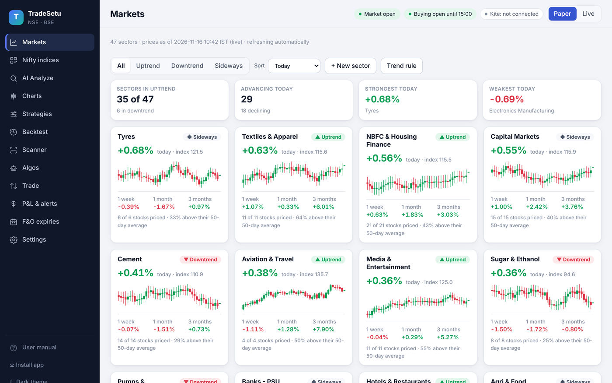 |
| **Charts**<br>Candles from 1 minute to daily (including 2, 3 and 4-minute), SMA/EMA, Bollinger, Supertrend, Donchian, daily, weekly and monthly pivots, and RSI, MACD and volume panels. Light and dark themes. | 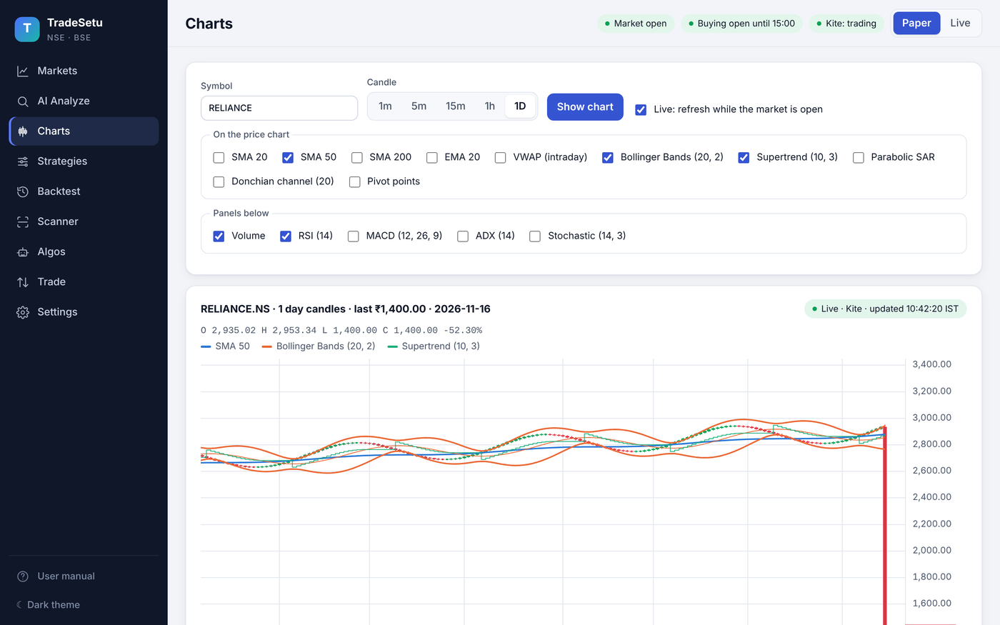 |
| **Option chain and F&amp;O**<br>Live chain with OI, IV, delta and max pain, F&amp;O expiries, index futures, and paper or live trades from the chain. | 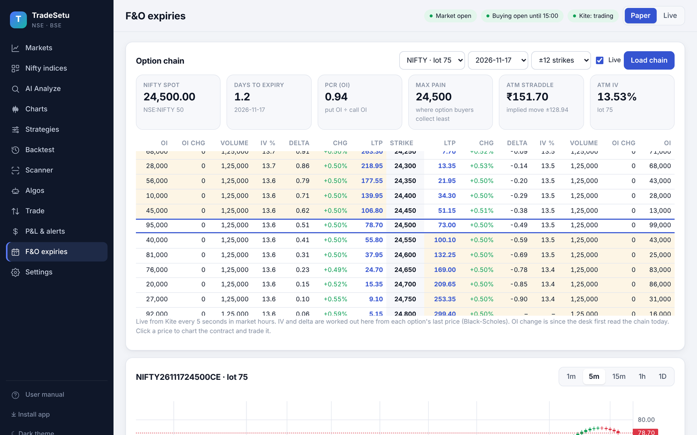 |
| **Option strategies and payoff**<br>Straddles, strangles, iron condors, spreads, butterflies, jade lizards and more, with payoff charts on today's market. | 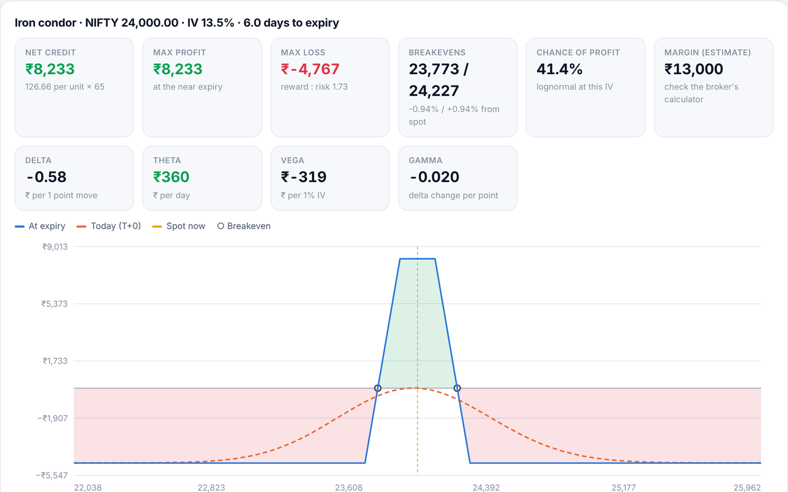 |
| **Strategy builder**<br>Combine indicators into Buy-when and Sell-when rules without code. Built-in strategies, plus strategies and screens inspired by well-known investors. | 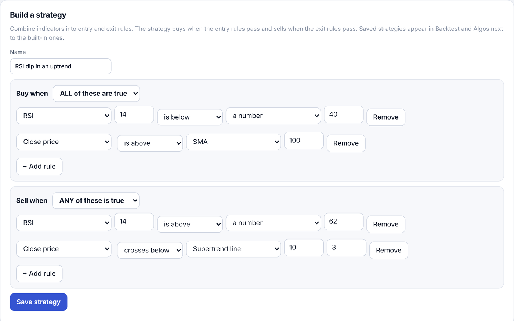 |
| **Backtests**<br>Daily and intraday backtests with Zerodha charges and slippage. Stoploss, target, trailing stop and re-entry rules. Option strategy, index futures and portfolio backtests. | 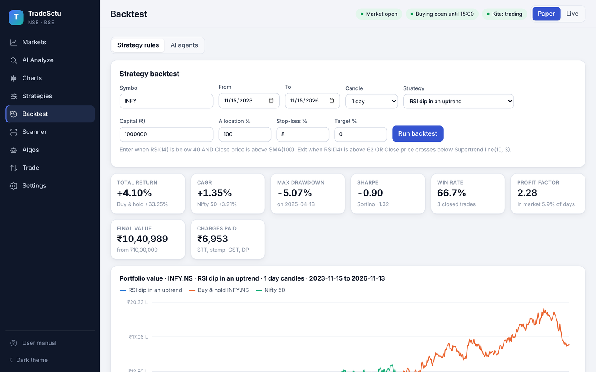 |
| **Walk-forward optimiser**<br>Tunes a strategy's settings on one period and tests them on the next, so the result isn't fitted to the past. | 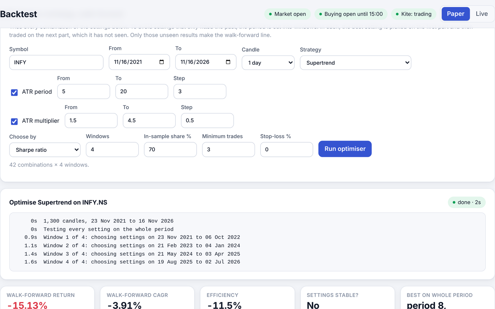 |
| **Breakout scanner**<br>Scans for breakouts and places GTT orders that never repeat. | 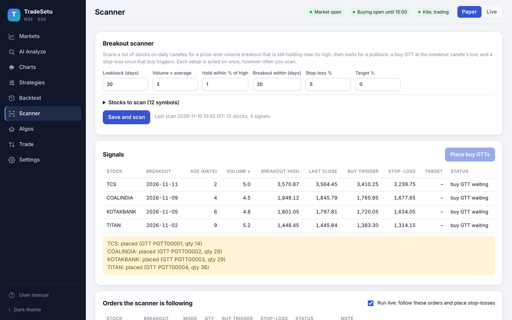 |
| **Algos**<br>Run a strategy by itself on a stock, an option strategy, an index future or MCX metals, on paper or live. Every algo order passes the same risk limits and kill switch as a manual order. | 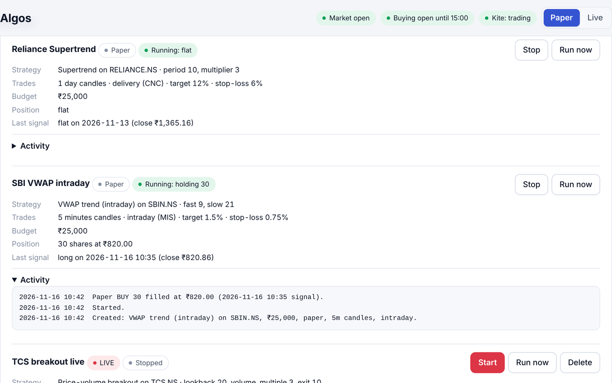 |
| **P&amp;L, alerts and tax export**<br>Realised and open P&amp;L by algo, a daily loss limit, Telegram alerts, and a CSV export for your tax filing. | 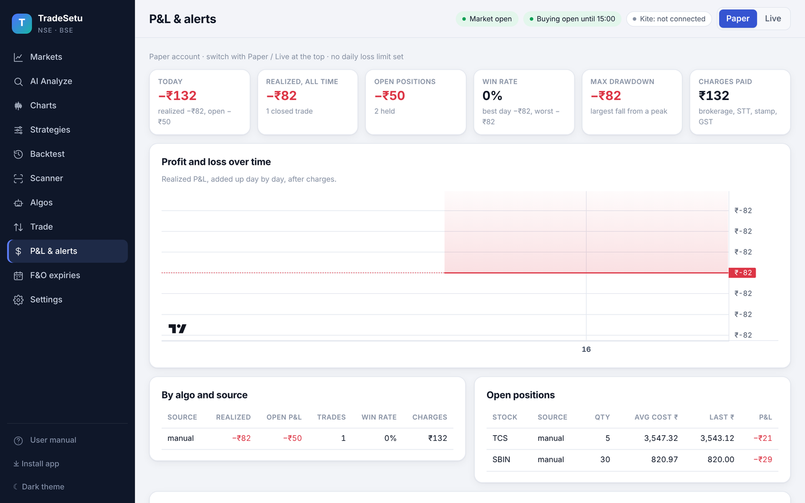 |
| **AI research (optional)**<br>A team of LLM agents (analysts, bull and bear researchers, a trader and a risk team) writes a report and a rating on one stock. Works with OpenAI, Anthropic, Google, DeepSeek, OpenRouter, Ollama and others. | 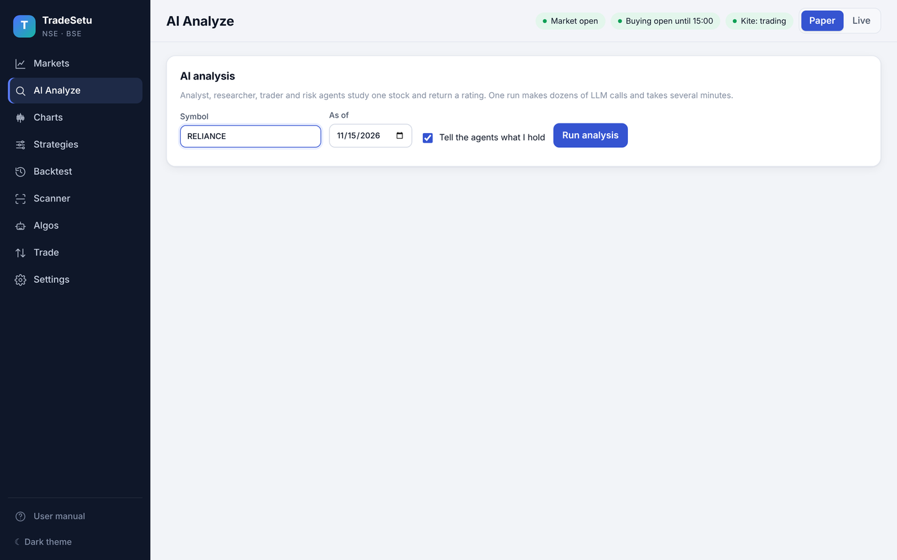 |
| **Secure by default**<br>Sign-in with two-factor codes or passkeys when hosted. Live orders stay off until you switch them on. Each manual order and each live algo needs a typed confirmation. | 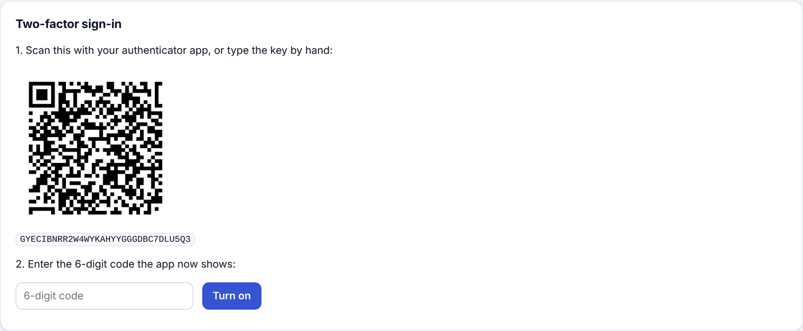 |

**Works on your phone too.** Install it as an app from the browser.

<p align="center">
  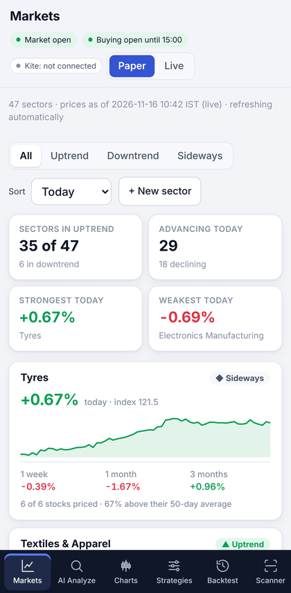
  &nbsp;&nbsp;
  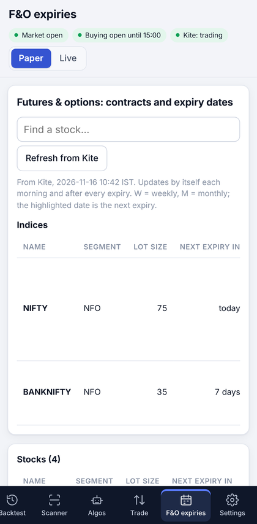
</p>

The [user manual](desk/static/manual/USER_MANUAL.md) explains every screen with screenshots. It is also in the app under **Help**.

## Setup guide

You need **Python 3.11 or later** and **Git**. For live orders you also need a **Zerodha account** with a [Kite Connect](https://developers.kite.trade) app (paid). Paper trading, charts and backtests work without Kite.

### Option A: on your own computer

```bash
git clone https://github.com/arvindbhosale/TradeSetu.git
cd TradeSetu

python -m venv .venv
source .venv/bin/activate          # Windows: .venv\Scripts\activate

pip install -e ".[desk,window]"
cp .env.example .env               # optional: only for the keys you want to keep there

tradesetu
```

The desk opens in a window, with no sign-in, and is reachable only from your computer. `tradesetu --browser` opens it in your web browser instead.

Then, in the app:

1. **Settings → Broker connection**: connect Kite. Zerodha's hosted server gives read-only access to holdings, positions and live prices. To place live orders, run [`kite-mcp-server`](https://github.com/zerodha/kite-mcp-server) with your Kite Connect key (see [desk/README.md](desk/README.md#kite-zerodha-connection)).
2. **Settings → AI model** (optional): choose a provider and paste its API key. You only need this for the Analyze tab.
3. Start on **Paper**. Switch to **Live** only after you have read the [going-live checklist](desk/static/manual/USER_MANUAL.md#12-going-live-checklist).

### Option B: on a server (VPS with Docker or Dokploy)

This runs the desk behind a sign-in at your own domain, with Zerodha's `kite-mcp-server` running privately beside it.

```bash
git clone https://github.com/arvindbhosale/TradeSetu.git
cd TradeSetu
cp .env.example .env    # set DESK_DOMAIN, DESK_ADMIN_PASSWORD, KITE_API_KEY, KITE_API_SECRET
docker compose up -d --build
```

Then, in your Kite Connect app:

- Set the **Redirect URL** to `https://<your-domain>/kite/callback`.
- Register your server's **static IP** (SEBI requires it for API orders).

The full guide, including Dokploy, HTTPS, backups and troubleshooting, is in [DEPLOY.md](DEPLOY.md).

### Configuration

Every setting is listed with comments in [`.env.example`](.env.example). Keys you paste in the app are stored in your data folder (`~/.tradingagents/desk`, or `TRADESETU_HOME`) with file mode 600, never in the repository.

### For developers

```bash
pip install -e ".[dev,desk]"
pytest -q            # about 1,700 tests, all offline
ruff check .
python -m desk.dev.fake_kite_mcp   # a stand-in Kite server for trying orders without an account
```

## Disclaimer

**Please read this before you use TradeSetu with real money.**

- **Not investment advice.** TradeSetu is open-source software for research and education. Nothing in this repository, the app, its backtests, signals, AI reports or built-in strategies is a recommendation to buy, sell or hold any security, derivative or commodity.
- **Not SEBI registered.** The authors and contributors are **not registered with the Securities and Exchange Board of India (SEBI)** as investment advisers, research analysts, stock brokers or algo providers, and are not empanelled with any exchange.
- **Your algos, your responsibility.** SEBI's framework for retail participation in algorithmic trading (circular of 4 February 2025, applied by brokers through 2025 and 2026) makes the broker responsible for API orders and requires every API order to carry the client's own API key and come from a registered static IP. When you run TradeSetu, the strategies run on **your own broker account and API keys**, and they are configured, switched on and supervised **by you**. You are solely responsible for:
  - every order placed through your keys, and for following SEBI, exchange and Zerodha rules;
  - registering a static IP with your broker, and getting any algo registration or approval your broker or exchange requires (for example, if your order rate goes above the exchange's threshold);
  - not offering your strategies to other people, for a fee or for free, without the registrations the law requires.
- **Backtests are not real results.** Past performance, simulated or real, does not predict future returns. Backtests leave out liquidity, circuit limits, partial fills, taxes and other real-world effects.
- **Trading involves risk.** Futures, options and commodities can lose more than you put in. SEBI's studies found that most individual F&amp;O traders lose money. Only trade money you can afford to lose.
- **No warranty.** The software is provided "as is", without warranty of any kind (see [LICENSE](LICENSE)). The authors are not liable for any loss, missed trade, wrong order or downtime, including those caused by bugs, data errors, broker or exchange outages, or changes in rules.

## Security

Please report vulnerabilities privately, as described in [SECURITY.md](SECURITY.md). Never post API keys, access tokens or your `.env` file in an issue.

## Contributing

Issues and pull requests are welcome. Please:

1. Open an issue first for anything larger than a small fix.
2. Add tests, and make sure `pytest -q` and `ruff check .` pass.
3. Never include real API keys, account details or client IDs, even in tests.

The maintainer reviews and merges every pull request.

## License

TradeSetu's own code (the `desk/` app and other new files) is under the [MIT License](LICENSE). The AI research package in `tradingagents/` and `cli/` is a modified version of [TradingAgents](https://github.com/TauricResearch/TradingAgents) and stays under the [Apache License 2.0](LICENSE-APACHE). See [LICENSE](LICENSE) and [NOTICE](NOTICE) for exactly which files fall under each license.
