# Trading Notes

Learning notes for the Indian market: how to read charts, what indicators measure, how futures and options work, which trade fits which market, and how to size and protect every position. Each chapter ends with how to do it in TradeSetu.

**How these notes were made.** Every price chart is drawn from real NSE end-of-day data (Yahoo Finance, data to 20 November 2026), and every pattern or signal shown was found by a written rule in the notes' build script, not drawn by eye. Every statistic is computed from that data or quoted from SEBI or NSE with the source named. Option payoffs and Greeks are exact arithmetic on a stated set of inputs. Screenshots of the desk show it with sample data. Rules, lot sizes and tax rates are as checked on 20 November 2026; they change, so the date matters.

**Nothing here is investment advice.** No pattern, indicator or strategy below has a guaranteed outcome, and several of the tests show the popular version losing to doing nothing. That is the most useful thing these notes can teach.

## Contents

**Part 1. Before you trade**

1. [How the Indian market works](#1-how-the-indian-market-works)
2. [Costs and taxes](#2-costs-and-taxes)
3. [What SEBI found about F&O traders](#3-what-sebi-found-about-fo-traders)

**Part 2. Reading charts**

4. [Candlesticks](#4-candlesticks)
5. [Trends](#5-trends)
6. [Support and resistance](#6-support-and-resistance)
7. [Chart patterns](#7-chart-patterns)

**Part 3. Indicators**

8. [Moving averages](#8-moving-averages)
9. [RSI](#9-rsi)
10. [MACD](#10-macd)
11. [Bollinger Bands and Supertrend](#11-bollinger-bands-and-supertrend)
12. [ATR, ADX, VWAP and pivot points](#12-atr-adx-vwap-and-pivot-points)

**Part 4. Strategies for stocks**

13. [Trend, breakout and mean-reversion strategies tested](#13-trend-breakout-and-mean-reversion-strategies-tested)

**Part 5. Futures**

14. [Futures](#14-futures)

**Part 6. Options**

15. [Option basics](#15-option-basics)
16. [Volatility and India VIX](#16-volatility-and-india-vix)
17. [The Greeks](#17-the-greeks)
18. [Option strategies](#18-option-strategies)
19. [F&O rules in force](#19-fo-rules-in-force)

**Part 7. Risk and putting it together**

20. [Risk and position sizing](#20-risk-and-position-sizing)
21. [Which trade, when](#21-which-trade-when)
22. [Sources and method](#22-sources-and-method)

---

## 1. How the Indian market works

### Exchanges and segments

| Segment | What trades there | Where |
|---|---|---|
| Equity cash | Shares and ETFs, bought for delivery or traded intraday | NSE, BSE |
| Equity derivatives (F&O) | Futures and options on indices (Nifty 50, Bank Nifty, Sensex and others) and on about 200 stocks | NSE (NFO), BSE (BFO) |
| Commodities | Gold, silver, crude oil and others | MCX |
| Currency | Rupee pairs | NSE, BSE |

### Trading hours (IST)

| Session | Time |
|---|---|
| Pre-open (orders collected, opening price found) | 09:00 to 09:15 |
| Normal market | 09:15 to 15:30 |
| Closing price | Weighted average of the last 30 minutes, 15:00 to 15:30 |

Shares settle T+1: shares bought today reach your demat account the next working day.

### Order types

| Order | What it does | Use it when |
|---|---|---|
| **Limit** | Buys or sells at your price or better. May not fill. | Almost always. It caps the price you pay. |
| **Market** | Fills at whatever the best price is now. | Only in very liquid instruments, and never in far option strikes. |
| **Stoploss (SL)** | Becomes a limit order once price touches the trigger. | Protecting a position; set the limit a little beyond the trigger so it fills in a fast fall. |
| **Stoploss market (SL-M)** | Becomes a market order at the trigger. | Not allowed for options on NSE. Can fill far from the trigger in a gap. |
| **GTT (good till triggered)** | Sits with the broker for up to a year; places a limit order when price reaches your level. | Targets and stops on delivery holdings you do not watch every day. |

### Products (Zerodha names)

| Product | Meaning |
|---|---|
| **CNC** | Delivery: you pay in full and keep the shares. |
| **MIS** | Intraday: the broker closes it before the market closes (about 15:20) if you do not. |
| **NRML** | Carry-forward F&O: held until you close it or it expires. |

**In TradeSetu:** orders, GTT and products are on **Trade** ([manual](/manual#9-trade-orders-gtt-kite)). Every order goes through your risk limits first. Paper mode uses the same screens with pretend money.

---

## 2. Costs and taxes

Costs are certain; profits are not. A strategy that trades often must beat its costs before it earns anything.

### Charges on each order

Zerodha's published schedule, as the desk uses it (`desk/charges.py`):

| Charge | Delivery | Intraday | Futures | Options |
|---|---|---|---|---|
| Brokerage | ₹0 | 0.03% or ₹20, lower | 0.03% or ₹20, lower | ₹20 an order |
| STT | 0.1% buy and sell | 0.025% sell | **0.05% sell** (from 1 Apr 2026, was 0.02%) | **0.15% of premium, sell** (from 1 Apr 2026, was 0.1%) |
| Exchange charge (NSE) | 0.00297% | 0.00297% | 0.00183% | 0.03553% of premium |
| SEBI fee | ₹10 a crore | ₹10 a crore | ₹10 a crore | ₹10 a crore |
| Stamp duty | 0.015% buy | 0.003% buy | 0.002% buy | 0.003% buy |
| GST | 18% on brokerage, exchange and SEBI charges | same | same | same |
| DP charge | ₹15.34 per stock sold from demat | none | none | none |

**A worked example.** Buy one Nifty option lot (65 units) at ₹200 and sell it at ₹250. The desk's charge calculator gives ₹29.46 on the buy and ₹54.81 on the sell, ₹84.27 in all, against a gross profit of 65 × 50 = ₹3,250. Small here, but the same ₹84 is paid on a losing trade too, and a trader who does five such round trips a day pays about ₹1 lakh a year in charges.

An in-the-money option left to expire is settled by the exchange and STT is charged on its intrinsic value, which can be far more than the STT on selling it. Close in-the-money options yourself before 15:30 on expiry day.

### Tax (individuals, as of November 2026)

| Income | How it is taxed |
|---|---|
| Shares held more than 12 months (LTCG) | 12.5% on gains above ₹1.25 lakh a year |
| Shares held 12 months or less (STCG) | 20% |
| Intraday equity | Speculative business income, at your slab rate |
| F&O | Non-speculative business income, at your slab rate; losses can be carried forward 8 years |

Tax rules have exceptions (surcharge, cess, audit limits, set-off rules). Use these rows to understand the shape, and a chartered accountant for your return.

**In TradeSetu:** every paper and live trade carries its charges; **P&L → Export** writes a tax summary split into these heads ([manual](/manual#export-and-tax-report)).

---

## 3. What SEBI found about F&O traders

SEBI has studied the profit and loss of individual traders in equity F&O several times. The numbers are after transaction costs.

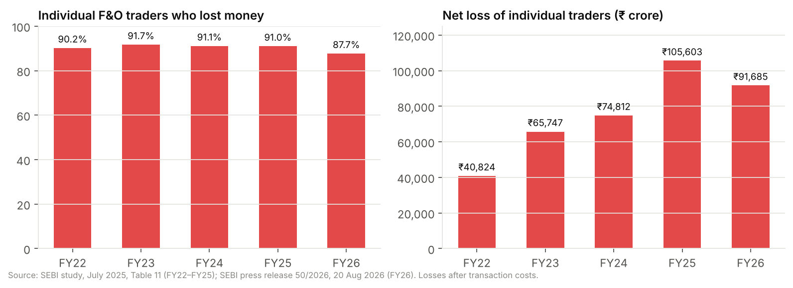

| Year | Individual traders who lost money | Net loss of individuals | Average loss per trader |
|---|---|---|---|
| FY22 | 90.2% | ₹40,824 crore | ₹95,517 |
| FY23 | 91.7% | ₹65,747 crore | ₹1,12,677 |
| FY24 | 91.1% | ₹74,812 crore | ₹86,728 |
| FY25 | 91.0% | ₹1,05,603 crore | ₹1,10,069 |
| FY26 | 87.7% | about ₹91,685 crore | about ₹1.17 lakh |

Sources: SEBI, *Comparative study of growth in Equity Derivatives Segment vis-à-vis Cash Market after recent measures*, July 2025, Table 11 (FY22 to FY25). SEBI press release 50/2026, 20 August 2026 (FY26). SEBI's September 2024 study found 93% of individual traders lost money over FY22 to FY24 taken together, with aggregate losses above ₹1.8 lakh crore.

What the FY26 study adds (as reported from SEBI's release of 20 August 2026):

- About 92% of individuals' losses came from **options**.
- About 97% of individual traders mainly **bought** options; about 2% mainly sold them, and only that group had a positive median return on capital.
- 59% of index-option turnover was in contracts on their **expiry day**.
- About 90% of traders who lost two years running lost again in the third.
- Proprietary traders and foreign investors made gross profits of about ₹44,000 crore and ₹14,000 crore; 99% of that came from algorithmic traders.

**What to take from this.** Buying cheap, near-expiry options is the most common trade and the most reliable way to lose. Read chapters [16](#16-volatility-and-india-vix) to [20](#20-risk-and-position-sizing) before trading F&O, and paper-trade first.

---

## 4. Candlesticks

### Reading one candle

A daily candle shows four prices for the day: **open**, **high**, **low** and **close**. The thick part (the body) runs from open to close: green when the close is above the open, red when below. The thin lines (wicks or shadows) reach the day's high and low.

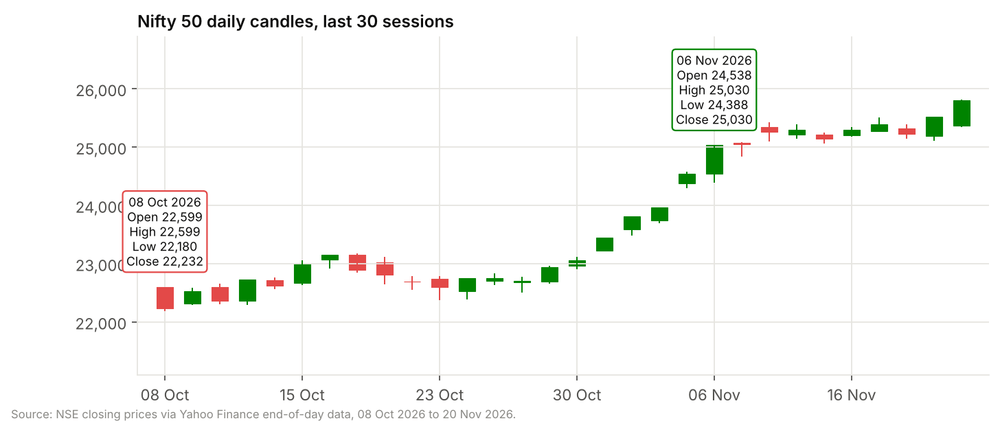

- A **long body** means one side was in control all session.
- A **long lower wick** means sellers pushed price down and buyers pushed it back.
- A **long upper wick** means buyers pushed up and sellers pushed it back.
- A **small body** with wicks on both sides means neither side won.

A candle can be any time span: 5 minutes, a day, a week. The same reading applies.

### Common patterns, defined exactly

These are the rules the notes use to find patterns. "After a fall" means the close is at least 3% below the close 10 sessions earlier; "after a rise" means at least 3% above. A "real" candle has a high-to-low range of at least 0.8 × its 14-day average true range, so a quiet day's speck is not counted.

| Pattern | Rule | Read as |
|---|---|---|
| **Doji** | Body no more than 10% of the day's range | Indecision |
| **Hammer** | After a fall; real candle; lower wick at least 2 × body; upper wick at most 10% of range | Buyers rejected lower prices |
| **Shooting star** | After a rise; real candle; upper wick at least 2 × body; lower wick at most 10% of range | Sellers rejected higher prices |
| **Bullish engulfing** | After a fall; a red candle, then a bigger green body that opens at or below the red close and closes at or above the red open | Buyers took over |
| **Bearish engulfing** | The mirror image after a rise | Sellers took over |
| **Morning star** | After a fall; a long red candle (body at least 60% of its range), a small body (at most 30% of the first) at or below the first close, then a green candle closing above the middle of the first body | Three-day turn up |
| **Evening star** | The mirror image after a rise | Three-day turn down |

### Real examples

The most recent example of each pattern among large Nifty stocks, found by the rules above. The title says what the close did 10 sessions later; some went the expected way and some did not.

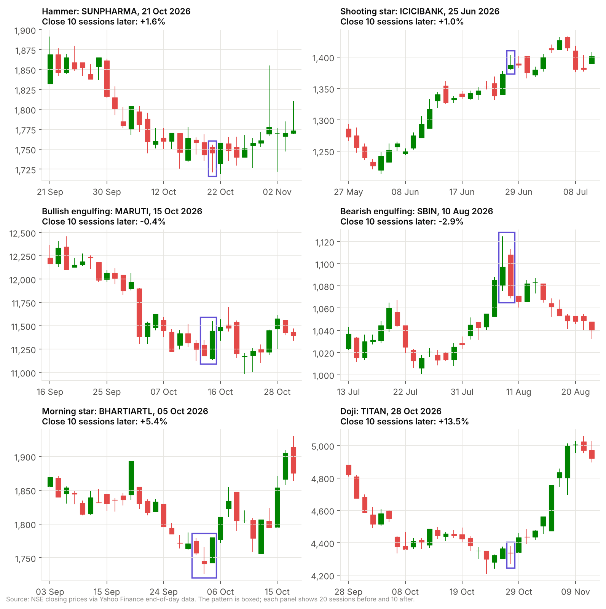

### Do they work? The count

Every occurrence in the current Nifty 50 stocks from 2015 to 20 November 2026, and what the close did 10 sessions later:

| Pattern | Times found | Higher 10 sessions later | Average move |
|---|---|---|---|
| Hammer | 306 | 49.0% | −0.24% |
| Bullish engulfing | 550 | 55.1% | +0.96% |
| Morning star | 103 | 65.0% | +2.32% |
| Doji | 8,009 | 54.0% | +0.69% |
| Shooting star | 421 | 51.1% | +0.53% |
| Bearish engulfing | 1,482 | 56.5% | +0.93% |
| Evening star | 151 | 62.3% | +1.53% |
| *Any day (baseline)* | 138,998 | 54.3% | +0.72% |

The baseline is any day at all: 54.3% of all 10-session periods ended higher, with an average move of +0.72%. Read the table against it.

- **Bearish patterns did not lead to falls.** After a bearish engulfing, shooting star or evening star, the stock was higher 10 sessions later in 51% to 62% of cases, against 54.0% for any day after a 3% rise. In a market that mostly rose over these years, betting on a single bearish candle meant betting against the trend.
- **Bullish patterns were no better than the baseline either.** After a 3% fall, any day was followed by a higher close 10 sessions later 54.9% of the time; a hammer 49.0%, a bullish engulfing 55.1%. Only the morning star did better (65.0%), on 103 cases, too few to rely on.
- A candle pattern is a description of one session's fight. On its own it has close to no predictive power on these stocks. Use it as a **trigger inside a plan**: at a support level you already identified, in the direction of the larger trend, with a stoploss beyond the pattern's low or high.

**In TradeSetu:** **Charts** draws candles at any interval from 1 minute to 1 day, with Heikin-Ashi as an option ([manual](/manual#4-charts)).

---

## 5. Trends

### Higher highs and higher lows

An **uptrend** is a series of higher swing highs (HH) and higher swing lows (HL). A **downtrend** is lower highs (LH) and lower lows (LL). Anything else is a range.

To make "swing" exact, the chart below marks a swing high or low each time the Nifty's close reversed at least 5% from its extreme.

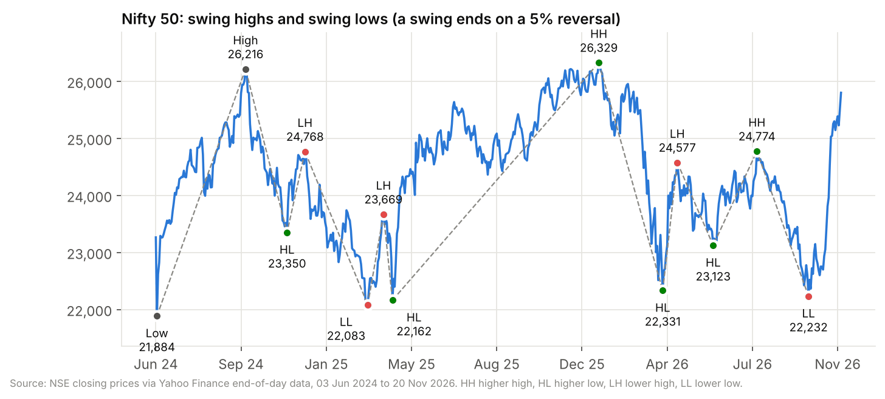

Reading it:

- From the 26,216 high (26 Sep 2024) the Nifty made a lower high (24,768) and a lower low (22,083): a downtrend by this rule until early 2025.
- The 22,162 low of April 2025 was a higher low; the run to 26,329 (2 Jan 2026) was a higher high: an uptrend.
- From there it fell to 22,331 by 30 Mar 2026, then moved in a wide range, with a lower low at 22,232 on 8 Oct 2026 before the rise into November.

Two practical rules follow:

1. **Trade with the trend of the time frame above yours.** A swing trader on daily candles checks the weekly trend; an intraday trader checks the daily.
2. **A trend ends only when its structure breaks.** In an uptrend, that is a close below the last higher low. Until then, a pullback is a pullback.

### Trend by moving average

A simpler and more mechanical test: is price above its moving average, and is the faster average above the slower one?

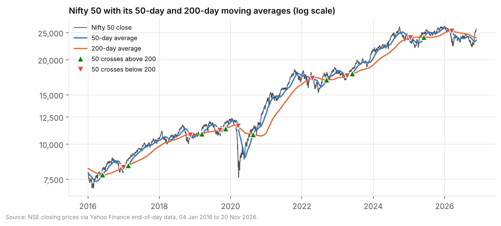

The 50-day average crossed above the 200-day (often called a golden cross) on 31 May 2016, 17 February 2017, 15 March 2019, 11 November 2019, 21 August 2020, 9 September 2022, 1 June 2023, 4 June 2025, and below it (a death cross) on 30 December 2016, 16 November 2018, 13 September 2019, 19 March 2020, 18 April 2022, 10 April 2023, 17 January 2025, 17 March 2026. Since 2016 the Nifty closed above its 200-day average on 74.6% of trading days.

Crosses are late by design: an average of 200 days cannot turn before the price has moved a long way. The cross in March 2020 came after most of that crash; the cross in June 2025 came after the Nifty had already risen from 22,162 to over 24,000. Chapter [13](#13-trend-breakout-and-mean-reversion-strategies-tested) tests what that lateness costs.

**In TradeSetu:** the Uptrend, Downtrend and Sideways badges on every sector, index and stock come from one rule you choose: two moving averages, price against one average, Supertrend direction, or return over a period ([manual](/manual#how-uptrend-and-downtrend-are-decided)).

---

## 6. Support and resistance

**Support** is a price area where falls have stopped before; **resistance** is where rises have stopped. They exist because traders remember prices: people who bought at a top want to get out at break-even, and people who missed a low buy when it comes back.

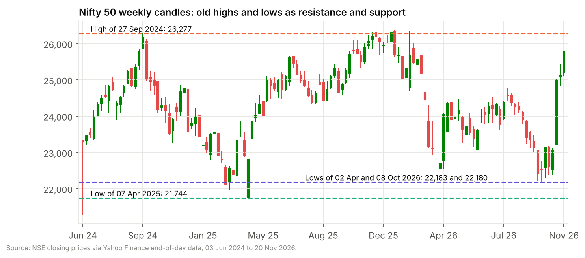

The Nifty's high of 26,277 on 27 September 2024 capped it for 14 months. The index first traded above it on 27 November 2025, got no further than 26,373 (5 January 2026) and closed above the old high on only one day before turning down: weekly highs sat within 1% of that level from October 2025 to February 2026. On the way down, two falls in 2026 stopped within a few points of each other: 22,183 on 2 April 2026 and 22,180 on 8 October 2026, a support zone a little above the April 2025 low of 21,744.

How to use levels:

- **Draw them from obvious turning points** on the daily or weekly chart: swing highs and lows, gaps, and round numbers (25,000, 26,000) where many orders sit.
- **Treat a level as a zone**, about the size of a normal day's range, not a line.
- **The more often a level is tested, the weaker it usually gets**, because the orders defending it are used up.
- **Broken resistance often becomes support** (and the other way round) as traders who missed the break buy the retest.
- **Place stops beyond the zone**, not at it, so normal noise does not take you out.

**In TradeSetu:** pivot levels (classic floor-trader pivots, daily, weekly or monthly) are drawn on the chart and usable in strategy rules ([chapter 12](#12-atr-adx-vwap-and-pivot-points)).

---

## 7. Chart patterns

Chart patterns are larger shapes made of several swings. The notes find them by rule on swing points (closes reversing at least 6%), and count them confirmed only when a close goes through the **neckline**. The **measured target** is the pattern's height projected from the neckline.

| Pattern | Rule used here | Read as |
|---|---|---|
| **Double top** | Two swing highs within 2% of each other, 15 to 120 sessions apart, with a swing low at least 8% below both between them. Confirmed by a close below that low (the neckline) within 60 sessions. | A failed second attempt at a high. Bearish. |
| **Double bottom** | The mirror image: two lows within 2%, a high at least 8% above, confirmed by a close above that high. | Bullish. |
| **Head and shoulders** | Three swing highs, the middle one at least 3% above the other two, which are within 4% of each other; the two lows between them within 4%. Confirmed by a close below the lower of those lows. | A top. Bearish. |

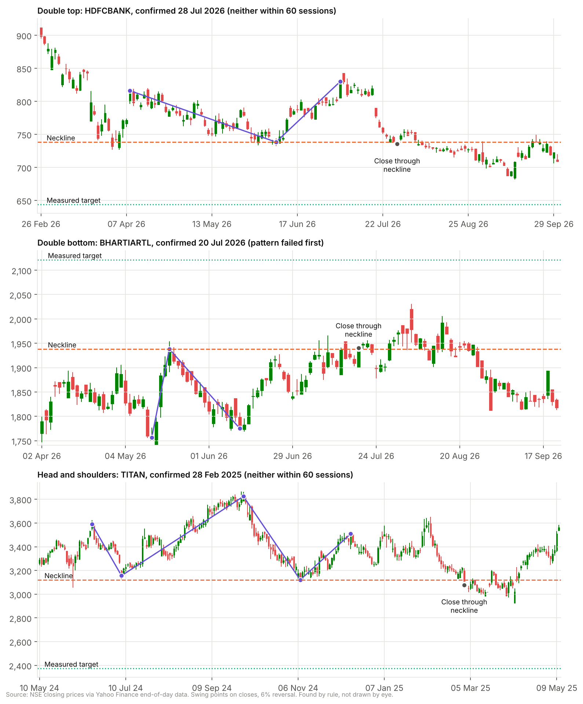

The three panels are the most recent confirmed examples in large Nifty stocks. None of them reached its measured target within 60 sessions, and the double bottom failed (price went back below the bottoms) first.

### The count

All confirmed patterns in the current Nifty 50 stocks, 2015 to 20 November 2026, followed for 60 sessions after the neckline close:

| Pattern | Confirmed | Target reached first | Failed first | 20 sessions later | Average 20-session move |
|---|---|---|---|---|---|
| Double top | 140 | 26.4% | 27.9% | 47.1% lower | −0.01% |
| Double bottom | 221 | 41.2% | 22.2% | 55.7% higher | +0.74% |
| Head and shoulders | 45 | 15.6% | 17.8% | 40.0% lower | +1.71% |

"Failed first" means price went back past the pattern's extreme (above the top, below the bottom) before reaching the target.

- Double bottoms behaved best, but even they reached their target before failing in well under half of cases.
- Tops did worse than a coin toss: 20 sessions after the neckline close, price was lower in 47.1% of double tops and 40.0% of head-and-shoulders tops, in a market that rose over the period.
- This is why patterns need a stop and a size, not just a target. The measured target is where to think about taking profit, not a forecast.

### Range breakouts and volume

A **range** (rectangle) is a stretch where price moves sideways between a ceiling and a floor. A breakout is a close outside it. Volume tells you whether many traders took part.

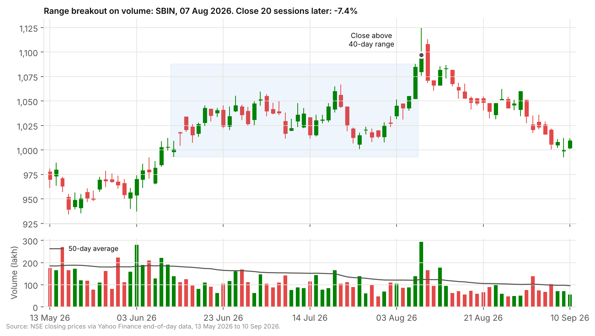

Rule used: the high-to-low range of the previous 40 sessions was 10% or less, the close went above that range's high, and the day's volume was at least 1.5 × its 50-day average. That happened 267 times in the Nifty 50 stocks since 2015; the close 20 sessions later was higher in 56.6% of cases (average +0.92%). The example above is the most recent in a large stock, and it failed: price fell back into the range within days.

**Triangles, flags and wedges** are the same idea with sloping boundaries: a breakout from a narrowing range. They were not tested here because their boundaries are hard to define by rule without drawing by eye. Treat them like any breakout: enter on a close outside, stop back inside, size so the stop costs a fixed small share of capital.

**In TradeSetu:** the **Scanner** finds stocks breaking out of their recent high on volume and can place GTT orders for them ([manual](/manual#7-scanner-breakouts-with-gtt-orders)).

---

## 8. Moving averages

| Average | Formula | Character |
|---|---|---|
| **SMA** (simple) | Mean of the last N closes | Smooth, slow to turn |
| **EMA** (exponential) | Each day: EMA = previous EMA + k × (close − previous EMA), k = 2 ÷ (N + 1) | Weights recent closes more; turns sooner, gives more false turns |

Common lengths: 20 days (about a month), 50 days, 200 days (about a year).

Uses:

- **Trend filter**: only buy when the close is above the 200-day average.
- **Crossovers**: buy when a fast average crosses above a slow one (20 over 50, 50 over 200).
- **Dynamic support**: in strong trends, pullbacks often stop near the 20- or 50-day average.

**Weakness**: every average lags. In a sideways market, price crosses back and forth and each cross is a small loss. See the [Nifty chart in chapter 5](#trend-by-moving-average) and the tests in [chapter 13](#13-trend-breakout-and-mean-reversion-strategies-tested).

---

## 9. RSI

The **Relative Strength Index** compares the size of recent up-closes to recent down-closes, on a 0 to 100 scale.

- Average gain and average loss over 14 sessions (Wilder's smoothing).
- RS = average gain ÷ average loss; **RSI = 100 − 100 ÷ (1 + RS)**.

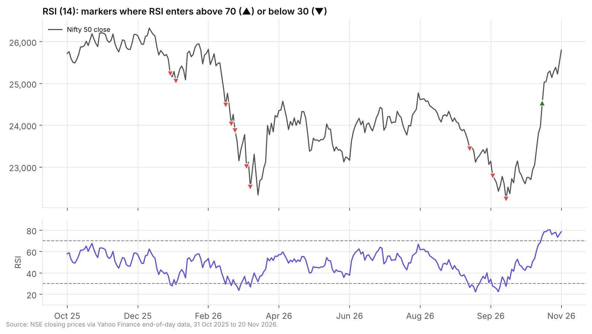

The usual reading is above 70 "overbought" and below 30 "oversold". In practice:

- **In a strong trend RSI stays extreme.** Since 2008 the Nifty's RSI was above 70 on 10.1% of days and below 30 on only 3.1%. Selling every time RSI crossed 70 meant selling strength in an index that mostly rose.
- **In the chart above**, RSI fell below 30 several times in early 2026 while the Nifty kept falling; it was a warning that the fall was strong, not a buy signal. It went above 70 in late October 2026, partway through a rise of more than 3,500 points from the October low, and stayed there into November while the rise went on.
- **Better uses**: in an uptrend (price above its 200-day average), a dip of RSI to 40 or below is a pullback to buy; in a downtrend, a rise to 60 is a bounce to sell into. **Divergence**, a new price high with a lower RSI high, shows the move is losing force, but can last for weeks.

On 20 November 2026 the Nifty's RSI(14) was 78.6.

---

## 10. MACD

**MACD line** = 12-day EMA − 26-day EMA. **Signal line** = 9-day EMA of the MACD line. **Histogram** = MACD − signal.

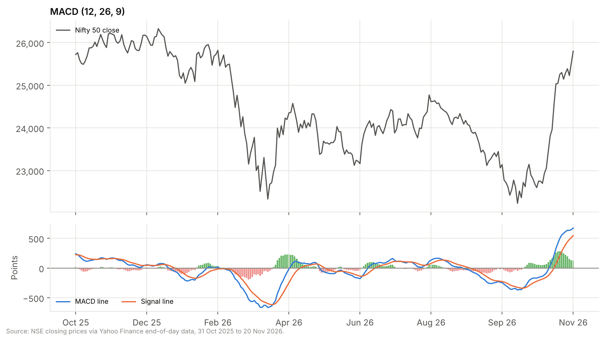

- MACD above zero: the short-term average is above the longer one, an uptrend in momentum terms.
- MACD crossing above its signal line: momentum turning up. The histogram shows the gap and shrinks before a cross.
- It lags, and in sideways markets it crosses often. On the Nifty from 2010, the rule "hold while MACD is above its signal" made 158 trades and won 37% of them ([chapter 13](#13-trend-breakout-and-mean-reversion-strategies-tested)).

---

## 11. Bollinger Bands and Supertrend

**Bollinger Bands**: a 20-day SMA with bands 2 standard deviations above and below. The bands widen when prices swing more and narrow when they calm down.

**Supertrend**: a trailing line at 3 × ATR(10) from the day's midpoint, below price in an uptrend and above in a downtrend. It flips when the close crosses it.

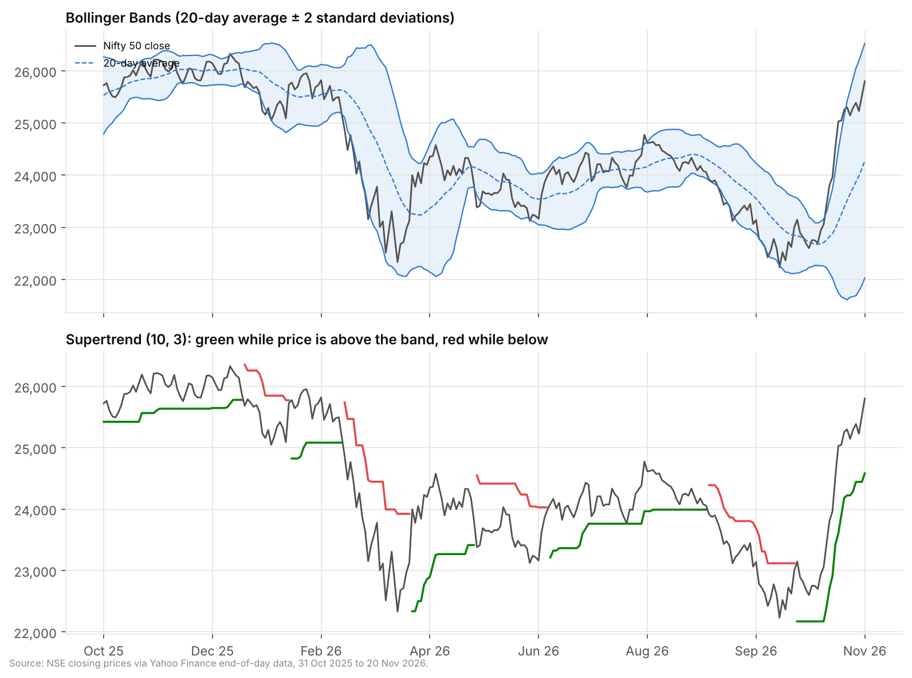

| Tool | Reading | Common mistake |
|---|---|---|
| Bollinger Bands | A close outside a band is unusual for that stock *recently*. A narrow band (a "squeeze") often comes before a big move, without saying which way. | Selling every touch of the upper band. In a strong trend price "walks the band" for weeks. |
| Supertrend | One line that says long or short and where the stop is. | Using it in a range: it flips repeatedly and each flip is a loss. |

**In TradeSetu:** both are on the chart's indicator menu and in the strategy builder ([manual](/manual#5-strategies-combine-indicators)).

---

## 12. ATR, ADX, VWAP and pivot points

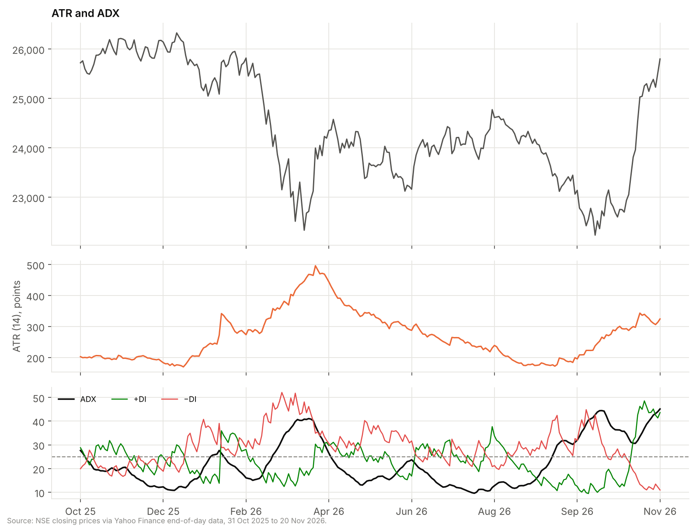

**ATR (Average True Range).** The average size of a day's move, gaps included: true range is the largest of high − low, |high − previous close| and |low − previous close|, averaged over 14 days. It is not a direction signal; it is the ruler for stops and position size. On 20 November 2026 the Nifty's ATR(14) was 324 points, so a stop 50 points away would have sat inside an ordinary day's noise.

**ADX.** Trend strength without direction, 0 to 100, built from +DI (strength of up-moves) and −DI (down-moves). Above about 25 is usually read as trending, below 20 as a range. Use it to choose a method: trend tools when ADX is high, range tools when it is low. On 20 November 2026 it was 45.1.

**VWAP (volume-weighted average price).** The average price of the day, weighted by volume, restarting each morning. Intraday traders and institutions treat it as the day's fair price: above VWAP buyers are in control for the day. It means nothing on a daily chart.

**Pivot points (classic).** From the previous period's high (H), low (L) and close (C):

| Level | Formula |
|---|---|
| Pivot P | (H + L + C) ÷ 3 |
| R1 / S1 | 2P − L / 2P − H |
| R2 / S2 | P + (H − L) / P − (H − L) |
| R3 / S3 | H + 2(P − L) / L − 2(H − P) |

They are popular intraday reference levels because many traders watch the same numbers.

**In TradeSetu:** the five-minute live chart shows VWAP and pivots ([manual](/manual#live-charts)).

---

## 13. Trend, breakout and mean-reversion strategies tested

Five popular rule sets, run through the desk's own backtester on real prices with Zerodha delivery charges and 0.05% slippage on every fill. Long only: in the market when the rule says so, in cash otherwise. Dividends are not included in any line.

### On the Nifty 50, 4 January 2010 to 20 November 2026

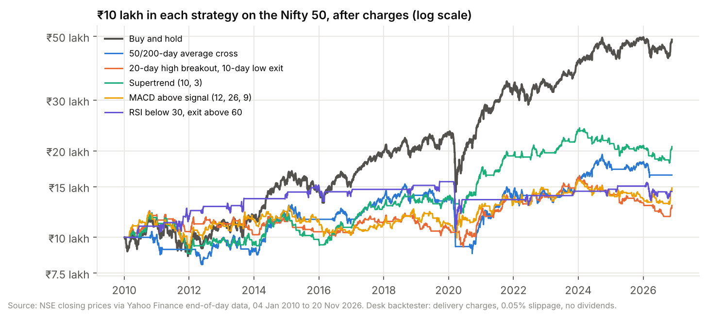

| Rule | Yearly return | Deepest fall | Trades | Winning trades | Time in market | Charges paid | ₹10 lakh became |
|---|---|---|---|---|---|---|---|
| Buy and hold | 9.84% | −38.4% | 0 | – | 100.0% | ₹1,184 | ₹48,77,250 |
| 50/200-day average cross | 3.00% | −42.8% | 12 | 50.0% | 65.8% | ₹32,155 | ₹16,46,824 |
| 20-day high breakout, 10-day low exit | 1.53% | −27.9% | 77 | 41.6% | 45.2% | ₹2,04,683 | ₹12,91,069 |
| Supertrend (10, 3) | 4.40% | −28.2% | 69 | 44.9% | 58.3% | ₹2,22,219 | ₹20,68,712 |
| MACD above signal (12, 26, 9) | 2.37% | −25.2% | 158 | 37.3% | 48.6% | ₹4,25,509 | ₹14,85,696 |
| RSI below 30, exit above 60 | 2.20% | −33.2% | 20 | 85.0% | 18.4% | ₹60,700 | ₹14,43,968 |

### On each of today's Nifty 50 stocks, 2015 to 20 November 2026

| Rule | Median yearly return | Median deepest fall | Beat buy and hold | Ended below the start |
|---|---|---|---|---|
| Buy and hold | 13.05% | −55.1% | – | 6.0% |
| 50/200-day average cross | 6.70% | −47.2% | 12.0% | 18.0% |
| 20-day high breakout, 10-day low exit | 2.29% | −40.0% | 6.0% | 32.0% |
| Supertrend (10, 3) | 4.59% | −42.9% | 6.0% | 18.0% |
| MACD above signal (12, 26, 9) | 3.29% | −43.1% | 4.0% | 28.0% |
| RSI below 30, exit above 60 | 3.45% | −41.3% | 2.0% | 30.0% |

Today's Nifty 50 members are stocks that did well enough to be in the index now, so buy and hold looks better here than it would have for a trader picking stocks in 2015 (survivorship bias). The comparison between the rules is still fair: every rule traded the same stocks.

### What this shows

- **None of the five beat buy and hold** on the Nifty since 2010, and each beat it on only 2% to 12% of the stocks.
- **Some cut the worst falls, some did not.** The deepest drop was 25% for MACD and 28% for the breakout and Supertrend rules, against 38% for buy and hold (2020). The 50/200 cross was worse, at 43%: it sold late in the 2020 crash and bought back late. Smaller drawdowns are the real case for trend rules, paid for with lower returns.
- **Costs matter more the more you trade.** MACD made 158 trades on the Nifty and paid ₹4.3 lakh in charges on ₹10 lakh of capital.
- **A high win rate is not a good strategy.** RSI reversion won 17 of its 20 trades on the Nifty (85%) and still compounded at only 2.2% a year. It was in the market 18% of the time, and its average loss (₹1.08 lakh) was 2.4 times its average win (₹45,000).

### Which kind of strategy fits which market

| Market | Fits | Fails |
|---|---|---|
| Strong trend (ADX above 25, price above a rising 200-day average) | Trend following: average crosses, Supertrend, breakouts of 20-day highs; buying pullbacks to the 20- or 50-day average | Selling "overbought" readings |
| Range (ADX below 20, flat averages) | Mean reversion: buying near support or the lower Bollinger Band, selling near resistance | Breakout and crossover rules: many small losses |
| Falling market | Cash, or hedges ([protective put](#protective-put-and-covered-call)); short futures only with strict stops | Buying dips without a stop |

No rule knows in advance which market it is in. The usual answer is a **filter** (trade breakouts only when ADX is high, mean reversion only when it is low) tested over many years and stocks, never on the one chart that looks good.

### Avoiding fooling yourself

- **Test on many stocks and many years**, including 2008, 2020 and sideways years.
- **Do not tune parameters until the curve looks good.** A rule with five tuned numbers fits the past and nothing else. Use walk-forward testing: tune on one stretch, test on the next.
- **Paper-trade for weeks** before live money, and compare paper results with the backtest. They will be worse.

**In TradeSetu:** **Backtest** runs any built-in or saved strategy with these costs, exit rules (stoploss, target, trailing) and a walk-forward optimiser ([manual](/manual#6-backtest)).

---

## 14. Futures

A **future** is an agreement to buy or sell an index or a stock at a fixed price on the expiry date. You pay a margin, not the full value, and the profit or loss is settled to your account every day (mark to market).

### The contract

| | Nifty 50 | Bank Nifty |
|---|---|---|
| Lot size (NSE, Nov 2026 to Jan 2027 series) | 65 | 30 |
| Close on 20 November 2026 | 25,800.60 | 64,635.20 |
| Value of one lot | about ₹16,77,039 | about ₹19,39,056 |
| Profit or loss per 1-point move | ₹65 | ₹30 |
| Monthly expiry | Last Tuesday of the month | Last Tuesday of the month |

Index futures are cash-settled. Stock futures are **physically settled**: if you hold a stock future into expiry you must take or give delivery of the shares.

### Leverage, in rupees

A 1% Nifty move on one lot is about ₹16,770. The Nifty moved more than 2% in a day on 126 days since 2015, and more than 3% on 136 days since 2008. The worst day in the data was −12.98% on 23 March 2020: a move that size from today's level would be about ₹2,17,680 on one lot, in one day. Margin is a deposit, not a limit on the loss.

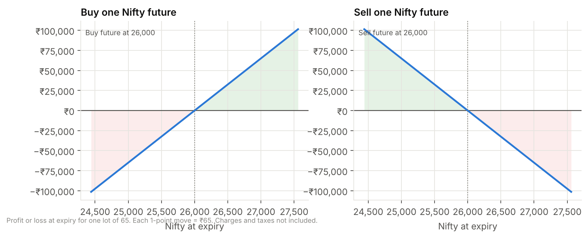

### Price of a future: basis and rollover

A future usually trades above the index by about the cost of carrying the position to expiry (interest minus expected dividends). That gap is the **basis**, and it shrinks to zero at expiry. To hold a position past expiry, close the near contract and open the next (**rollover**), paying a round trip of charges and the difference in basis.

### When futures fit

- **A directional view with a stop**, when the stop distance in points times the lot size is a loss you accept (see [position sizing](#20-risk-and-position-sizing)).
- **Hedging a portfolio.** Selling Nifty futures against a stock portfolio cuts its market risk. To hedge ₹30 lakh of stocks that move like the Nifty, sell about ₹30 lakh ÷ ₹16,77,039 ≈ 1.8 lots.

**In TradeSetu:** **F&O → Index futures** shows prices and charts; **Backtest → Index futures** tests any strategy in lots with margin, rollover and charges ([manual](/manual#index-futures-prices-and-charts)).

---

## 15. Option basics

| Word | Meaning |
|---|---|
| **Call (CE)** | The right to buy at the strike price on expiry. Gains when the index rises. |
| **Put (PE)** | The right to sell at the strike. Gains when the index falls. |
| **Premium** | The option's price, per unit. You pay it as a buyer, receive it as a seller. One lot of a Nifty option at ₹200 costs 200 × 65 = ₹13,000. |
| **Strike** | The price in the contract. Nifty strikes are 50 points apart. |
| **ATM / ITM / OTM** | At the money (strike near the index), in the money (a call below the index, a put above), out of the money (the rest). |
| **Intrinsic value** | What it would pay if it expired now: index − strike for a call, strike − index for a put, never below zero. |
| **Time value** | Premium − intrinsic value. It falls to zero by expiry. |

Index options in India are **European** (exercised only at expiry) and **cash-settled**. Nifty has weekly expiries on **Tuesday**; Sensex on BSE on **Thursday**. Every other index has a monthly expiry only.

### The four basic positions

The examples in Part 6 use one stated set-up so you can check every number: Nifty at 26,000, lot 65, implied volatility 13%, interest 6%, 7 days to expiry. Premiums are Black-Scholes values for those inputs (26,000 CE ₹202.0, 26,000 PE ₹172.1). They are not market quotes, which differ.

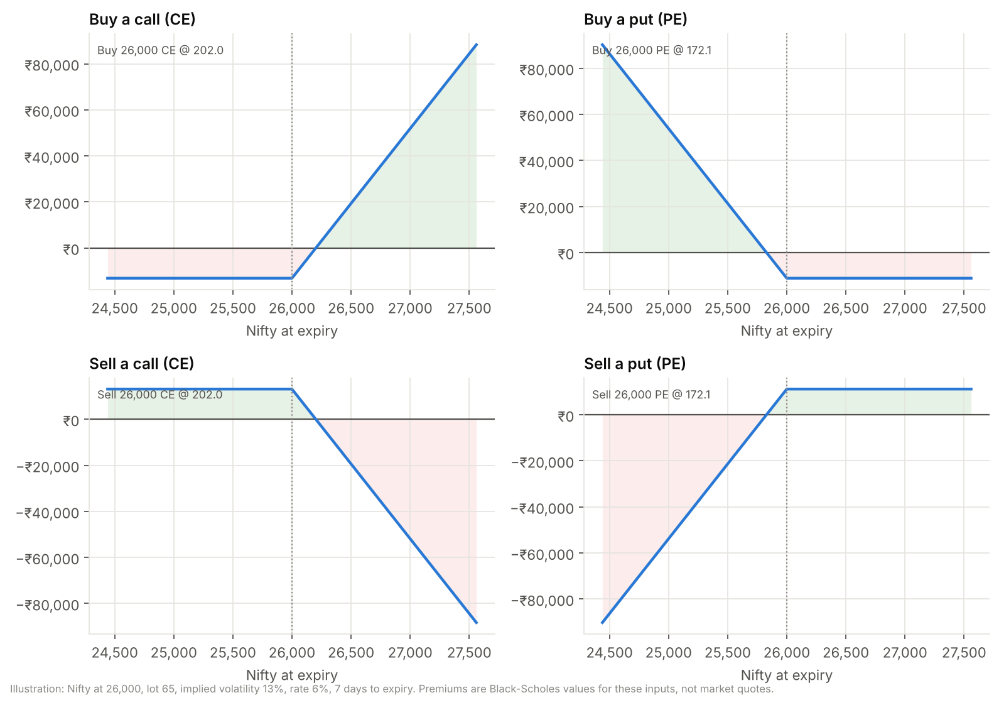

| Position | Max profit | Max loss | Breakeven at expiry |
|---|---|---|---|
| Buy 26,000 CE at 202.0 | Unlimited | ₹13,130 (the premium) | 26,202 |
| Buy 26,000 PE at 172.1 | ₹1,18,814 (if the Nifty went to 0) | ₹11,186 | 25,828 |
| Sell 26,000 CE at 202.0 | ₹13,130 | **Unlimited** | 26,202 |
| Sell 26,000 PE at 172.1 | ₹11,186 | ₹1,18,814 | 25,828 |

A buyer needs the index to move past the breakeven **before expiry**; being right a week late is a loss. A seller wins if the index does not move much, but one large move can cost many months of premiums.

**In TradeSetu:** the **option chain** shows every strike with live premiums; you can track, paper-trade or place live orders from it ([manual](/manual#option-chain-track-paper-and-live-trade)).

---

## 16. Volatility and India VIX

An option's premium depends mostly on how much the market expects the index to move before expiry. That expectation, as a yearly percentage, is **implied volatility (IV)**. **India VIX** is NSE's index of the Nifty options' implied volatility for the next 30 days.

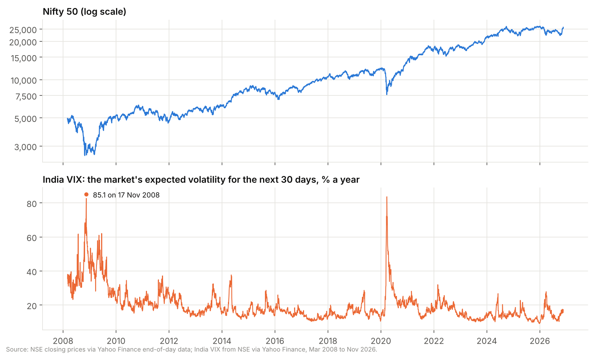

- VIX was 17.32 on 20 November 2026; its median since 2015 is 15.29. Its highest close in the data is 85.13 on 17 November 2008; it reached the 80s again in March 2020.
- VIX jumps when the market falls fast. Option premiums jump with it, which is why puts bought in a panic are expensive.

**A rough rule:** VIX ÷ √12 is the market's one-month expected move. At a VIX of 16, that is about 4.6%: the market prices a one-month move of about ±4.6% as roughly a one-standard-deviation event.

### Expected against what happened

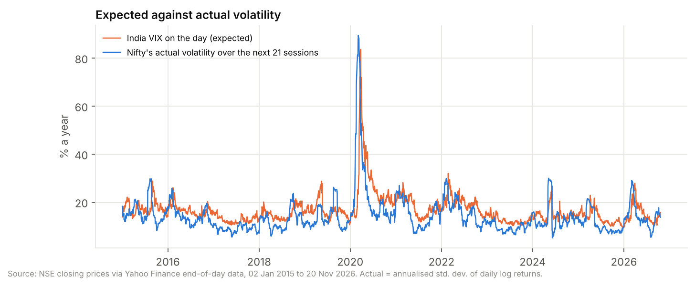

Since 2015, India VIX was above the volatility the Nifty actually showed over the following month on 79.8% of days. Options were usually priced for more movement than came. That gap is why option sellers earn money most months, and why the SEBI study found sellers did better than buyers. The exceptions, such as early 2020, are where sellers lose very large amounts at once. A seller's edge exists only with a hard limit on the worst case.

---

## 17. The Greeks

The Greeks measure how an option's premium changes. Same set-up as chapter 15.

| Greek | Measures | 26,000 CE, 7 days left |
|---|---|---|
| **Delta** | Change in premium for a 1-point index move. Calls 0 to 1, puts 0 to −1. Also a rough chance of expiring in the money. | 0.53: a 100-point rise adds about ₹53 to the premium, ₹3,445 a lot |
| **Gamma** | Change in delta for a 1-point move | 0.00085: delta rises about 0.085 for a 100-point move |
| **Theta** | Premium lost per day, the index unchanged | −₹15.5 a day, about ₹1,010 a lot |
| **Vega** | Change in premium for a 1-point change in IV | ₹14.3, about ₹930 a lot |

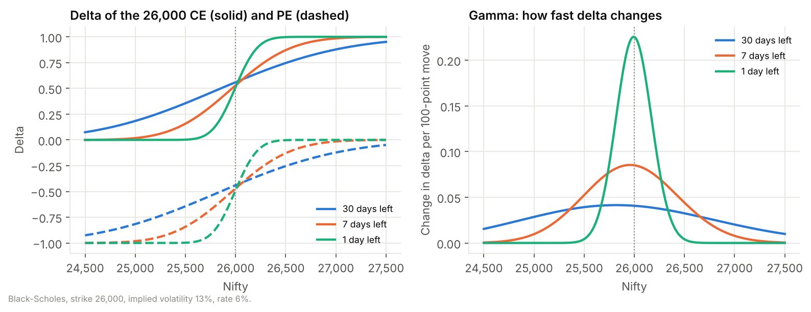

**Delta and gamma.** Far from expiry, delta changes slowly. In the last days, delta near the strike flips from almost 0 to almost 1 within a few hundred points: gamma is highest at the money on expiry day. That is why expiry-day option prices jump around, and why short options on expiry day are the riskiest position in the market.

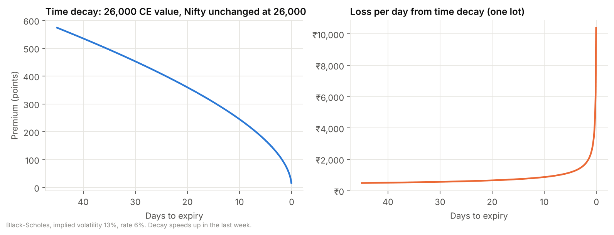

**Theta.** With the Nifty unchanged at 26,000, the ATM call is worth 452.9 with 30 days left, 202.0 with 7 days and 72.7 with 1 day. Decay per lot rises from about ₹565 a day at 30 days to about ₹2,430 on the last day. A buyer of a weekly option pays this every day; a seller collects it.

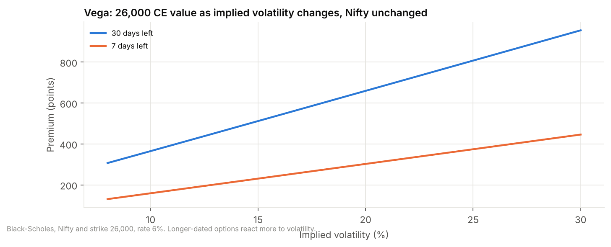

**Vega.** At 30 days, the same call is worth 365.0 at 10% IV, 452.9 at 13% and 659.3 at 20%. After an expected event (results, budget, an election), IV usually drops and premiums fall even if the index moves your way. This is called IV crush.

**In TradeSetu:** **Payoff now** on any option strategy shows its Greeks, breakevens and margin on today's prices ([manual](/manual#payoff-now)).

---

## 18. Option strategies

Every chart and number uses the chapter 15 set-up (Nifty 26,000, lot 65, IV 13%, 7 days). "Max profit" and "max loss" are per lot at expiry, before charges.

### Protective put and covered call

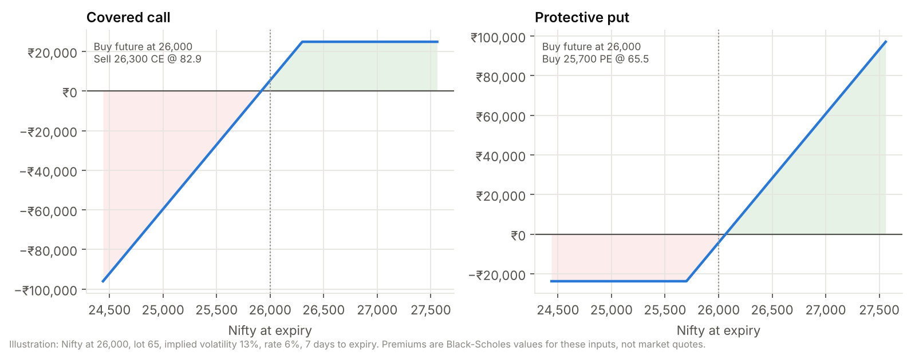

| | Covered call | Protective put |
|---|---|---|
| Legs | Long Nifty (here a future at 26,000), sell 26,300 CE at 82.9 | Long Nifty future at 26,000, buy 25,700 PE at 65.5 |
| Max profit | ₹24,889 (Nifty at or above 26,300) | Unlimited |
| Max loss | Large: the holding's fall, cushioned by 82.9 points | ₹23,758 (Nifty at or below 25,700) |
| Breakeven | 25,917 | 26,066 |
| Fits | You hold and expect a flat or slowly rising market; you accept giving up gains above the strike | You hold and fear a fall (results, events); insurance for a fee |

### Vertical spreads (directional, limited risk)

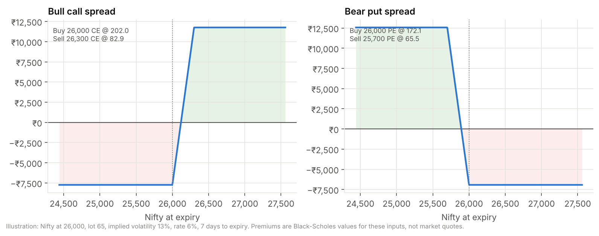

| | Bull call spread | Bear put spread |
|---|---|---|
| Legs | Buy 26,000 CE at 202.0, sell 26,300 CE at 82.9 | Buy 26,000 PE at 172.1, sell 25,700 PE at 65.5 |
| Cost (max loss) | ₹7,742 | ₹6,929 |
| Max profit | ₹11,759 (Nifty at or above 26,300) | ₹12,571 (at or below 25,700) |
| Breakeven | 26,119 | 25,893 |
| Fits | Moderately bullish, with a target | Moderately bearish, with a target |

The sold leg pays for part of the bought one, so the spread needs a smaller move than a bare call or put (breakeven 26,119 against 26,202), loses less to time decay and to falls in IV, and caps the gain.

### Long straddle and strangle (expecting a big move)

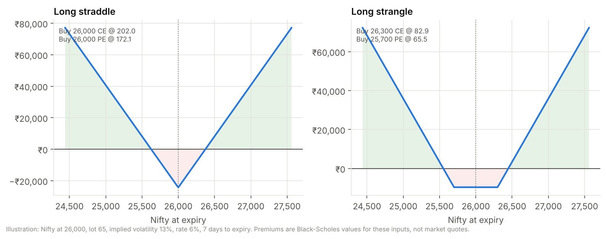

| | Long straddle | Long strangle |
|---|---|---|
| Legs | Buy 26,000 CE and 26,000 PE | Buy 26,300 CE and 25,700 PE |
| Cost (max loss) | ₹24,316 | ₹9,646 |
| Breakevens | 25,626 and 26,374 | 25,552 and 26,448 |
| Fits | A big move either way is likely and IV is low | Same, cheaper, needs a bigger move |

The Nifty must move about 1.4% (straddle) or 1.7% (strangle) by expiry just to break even. Buying these right before a known event usually means paying high IV, which collapses afterwards.

### Short straddle and strangle (expecting a quiet market)

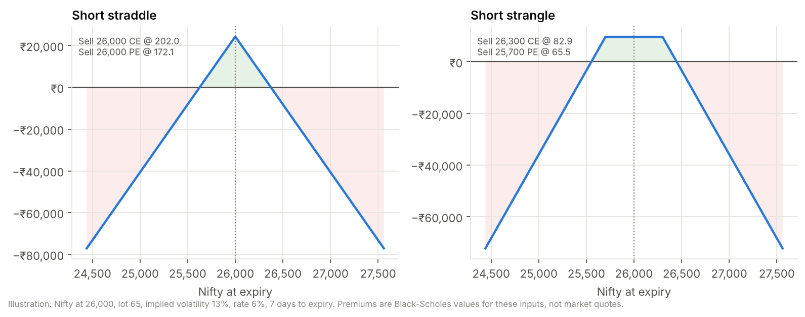

| | Short straddle | Short strangle |
|---|---|---|
| Legs | Sell 26,000 CE and 26,000 PE | Sell 26,300 CE and 25,700 PE |
| Max profit | ₹24,316 | ₹9,646 |
| Max loss | **Unlimited** | **Unlimited** |
| Breakevens | 25,626 and 26,374 | 25,552 and 26,448 |

These win often and lose big. Without a hedge, a 5% gap (the Nifty had 35 days moving more than 5% since 2008) costs many times the premium. Prefer the iron versions below, which cap the loss.

### Iron condor and iron butterfly (quiet market, limited risk)

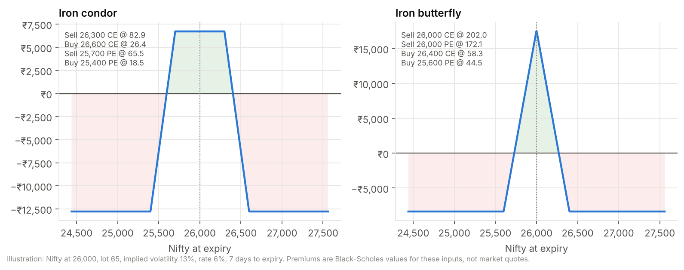

| | Iron condor | Iron butterfly |
|---|---|---|
| Legs | Sell 26,300 CE and 25,700 PE; buy 26,600 CE and 25,400 PE | Sell 26,000 CE and PE; buy 26,400 CE and 25,600 PE |
| Max profit | ₹6,728 (Nifty between 25,700 and 26,300) | ₹17,634 (Nifty exactly at 26,000) |
| Max loss | ₹12,773 | ₹8,366 |
| Breakevens | 25,596 and 26,404 | 25,729 and 26,271 |
| Fits | Range-bound market, IV high (premium rich) | Same, with a firm view the index stays near one level |

The bought wings cap the loss and cut the margin needed. Place the **buy legs first**, then the sells, so the margin benefit applies and a sell order is not rejected.

### Choosing a strategy

| Your view | IV low (cheap options) | IV high (expensive options) |
|---|---|---|
| Up | Buy a call, or a bull call spread | Bull put spread (sell a put, buy a lower put), or covered call if you hold |
| Down | Buy a put, or a bear put spread | Bear call spread (sell a call, buy a higher call) |
| Big move, either way | Long straddle or strangle | Usually avoid: the move is already priced in |
| Little movement | Usually avoid: little premium to collect | Iron condor or iron butterfly |
| Holding stocks and worried | Protective put | Collar: protective put paid for by a covered call |

Before any option trade, write down: the maximum loss in rupees, the exit if the index goes against you, and the exit if nothing happens by a set day.

**In TradeSetu:** **Backtest → Option strategy** has 34 strategies with their legs, payoff, Greeks and margin, and a backtest on real index prices with simulated premiums ([manual](/manual#option-strategies-straddles-condors-spreads-hedges)). Simulated premiums use India VIX and Black-Scholes, so they miss skew and sudden IV changes; treat those backtests as rough.

---

## 19. F&O rules in force

As checked on 20 November 2026.

### Index lot sizes (NSE)

| Index | Lot size | Revised |
|---|---|---|
| Nifty 50 | 65 | From the January 2026 series (was 75) |
| Nifty Bank | 30 | From the January 2026 series (was 35) |
| Nifty Financial Services | 60 | From the January 2026 series (was 65) |
| Nifty Midcap Select | 120 | From the January 2026 series (was 140) |
| Nifty Next 50 | 25 | Unchanged |

Source: NSE `fo_mktlots.csv`, read 20 November 2026 (Nov-26, Dec-26 and Jan-27 columns). NSE reviews lot sizes twice a year so that one lot is worth ₹15 to 20 lakh. Stock lots were last revised in October 2026; some change from the January 2027 expiry (for example HDFC Bank 650 to 750, Infosys 400 to 500). Always check the lot size on the order screen.

### SEBI's index-derivative measures (circular of 1 October 2024)

| Measure | In force from |
|---|---|
| Minimum value of an index contract raised to ₹15 lakh (lot sizes set so one lot is ₹15 to 20 lakh) | New contracts from late November 2024 |
| Weekly expiry on only one benchmark index per exchange (NSE: Nifty 50; BSE: Sensex) | 20 November 2024 |
| Extra 2% extreme-loss margin on short options on their expiry day | 20 November 2024 |
| Option premium collected from buyers upfront (no buying on intraday leverage) | February 2025 |
| No calendar-spread margin benefit on the expiry day of the expiring leg | February 2025 |
| Position limits checked during the day, not only at the close | April 2025 |

### Other rules

- **Expiry days.** NSE index options and futures expire on Tuesday (from September 2025; Thursday before). BSE's expire on Thursday. When the day is a holiday, expiry moves to the previous trading day.
- **Settlement.** Index F&O is cash-settled. Stock F&O is physically settled: an in-the-money stock option or an open stock future at expiry means delivering or receiving the shares, with the full value needed.
- **STT** from 1 April 2026: futures 0.05% of value on the sell side; options 0.15% of premium on the sell side.

**In TradeSetu:** **F&O expiries** lists every index and stock with F&O, its lot size and expiry dates, read from Kite's contract list when you are logged in ([manual](/manual#fo-expiries)).

---

## 20. Risk and position sizing

Most traders lose not because their entries are bad but because one or two losses are too large.

### Losses compound against you

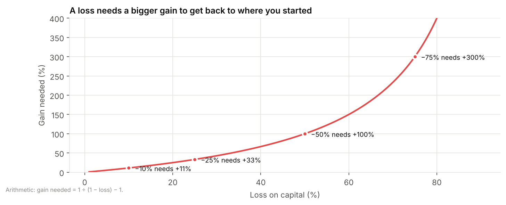

A 50% loss needs a 100% gain to get back. Keeping each loss small keeps the hole shallow enough to climb out of.

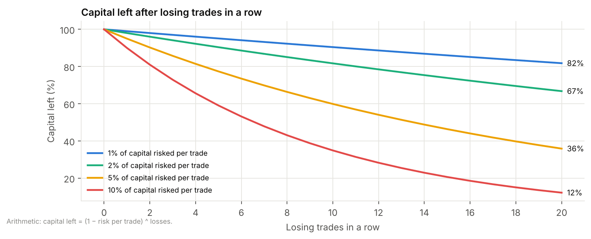

Streaks happen even with a good method. With a 45% win rate, a run of 8 losses in a row is likely somewhere in a few hundred trades. Risking 2% per trade, 10 losses in a row leaves 82% of capital; risking 10%, it leaves 35%.

### The sizing rule

Decide the stop first, then the size:

**Quantity = (capital × risk per trade) ÷ (entry − stop)**

Example: capital ₹5 lakh, risk 1% (₹5,000). Buying a stock at ₹1,200 with the stop at ₹1,150 (₹50 risk a share) gives 5,000 ÷ 50 = 100 shares (₹1.2 lakh of stock). If the stop is wider, the quantity is smaller; the rupee risk stays ₹5,000.

**Using ATR for the stop.** A stop 1.5 to 2 × ATR from the entry sits outside normal noise. For the Nifty on 20 November 2026 (ATR 324), that is roughly 487 to 649 points, ₹31,639 to ₹42,185 on one futures lot. If that is more than your 1 to 2% risk, the position is too big for your capital; the answer is a smaller instrument (an ETF, an option spread), not a tighter stop.

**For F&O**, the risk is the stop distance × lot size × lots, or for a bought option, the premium you are willing to lose. Count margin as a deposit, not as the risk.

### Even the index falls hard

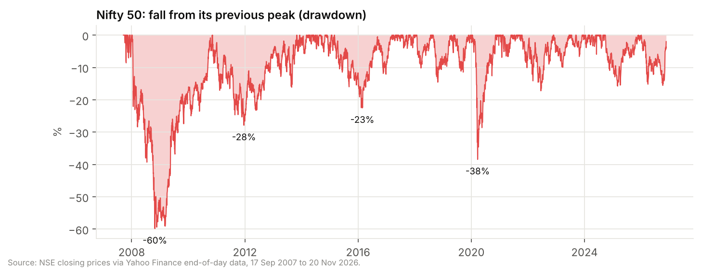

Every fall of more than 20% from a peak since the Nifty 50 data begins (September 2007):

| Peak | Lowest close | Fall | Back at the old peak |
|---|---|---|---|
| 8 January 2008 | 27 October 2008 | −59.9% | 9 November 2010 |
| 9 November 2010 | 20 December 2011 | −27.9% | 1 November 2013 |
| 3 March 2015 | 25 February 2016 | −22.5% | 14 March 2017 |
| 14 January 2020 | 23 March 2020 | −38.4% | 9 November 2020 |

A buyer at the January 2008 peak waited almost three years to be level again, before costs and inflation. Size every position so that a fall like these does not end your trading.

### Rules worth keeping

1. **Risk 0.5% to 2% of capital per trade.** Never add to a loser.
2. **Set a daily loss limit** and stop for the day when it is hit.
3. **Know your total risk**: five positions in banking stocks are one position.
4. **No naked short options** unless you can survive the worst day in the [daily-moves chart](#the-shape-of-daily-moves) on every position at once.
5. **Keep a journal**: entry reason, stop, exit, result. Review it monthly.

### The shape of daily moves

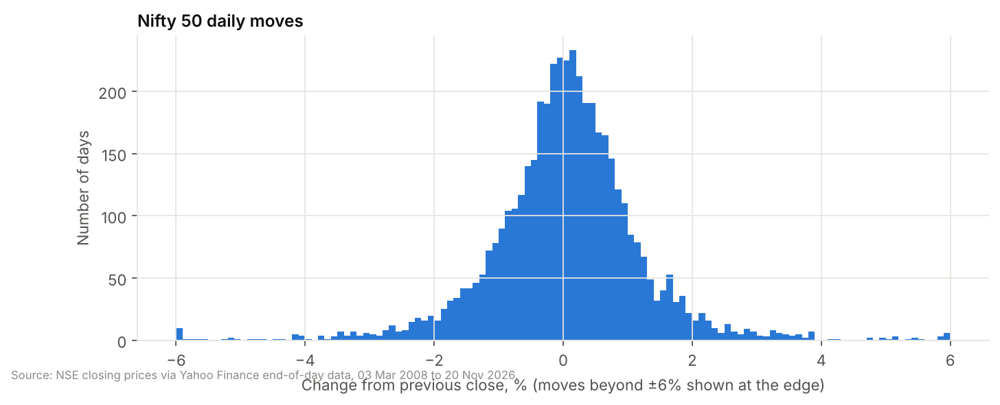

Most days are small; a few are very large. Of 4,588 sessions since March 2008, 360 moved more than 2%, 136 more than 3% and 35 more than 5%. A stop does not protect against a gap: if the market opens below your stop, you are filled at the open.

**In TradeSetu:** **Settings → Risk limits** sets the maximum order value, orders a day, and a **daily loss limit** that turns on the kill switch by itself; every order, yours or an algo's, passes these checks ([manual](/manual#risk-limits)).

---

## 21. Which trade, when

A summary of the chapters as a decision table. Each row still needs a stop and a size from [chapter 20](#20-risk-and-position-sizing).

| Situation (how to see it) | Trade that fits | Instrument | Exit |
|---|---|---|---|
| **Uptrend**: higher highs and lows, price above a rising 50- and 200-day average, ADX above 25 | Buy pullbacks to the 20/50-day average or to old resistance; buy breakouts of a tight range on volume | Shares (CNC), or a bull call spread | Close below the last higher low, or a trailing stop such as Supertrend |
| **Downtrend**: lower highs and lows, price below a falling 200-day average | Stay in cash; hedge holdings | Protective put, or short Nifty futures against a portfolio | Close above the last lower high |
| **Range**: flat averages, ADX below 20, clear support and resistance | Buy near support, sell near resistance | Shares; or an iron condor when IV is high | Close outside the range |
| **Quiet market, high IV** (VIX above its usual level, no event ahead) | Sell premium with limited risk | Iron condor, iron butterfly, credit spreads | Stop at about 2 × premium received, or a set time before expiry |
| **Event ahead, IV low** | Buy movement | Long straddle or strangle, sized as a total loss | Close soon after the event |
| **Event ahead, IV high** | Usually stand aside; the move is priced | | |
| **Panic day, VIX spiking** | Do not buy expensive puts late; do not sell naked options | Reduce size | |

### Before every trade

1. What is the trend on my time frame and the one above?
2. Where is the nearest support and resistance?
3. Where is my stop, and why there?
4. What quantity makes that stop cost 1% of capital?
5. What are the charges, and is the target worth several times them?
6. For options: what is IV compared with usual, and how many days of decay will I pay?
7. What will make me exit if nothing happens?

**In TradeSetu:** build the rule in **Strategies**, test it in **Backtest** on many stocks and years, run it in **Paper** as an algo for several weeks, and only then switch it to Live ([manual](/manual#8-algos-automatic-trading)).

---

## 22. Sources and method

**Prices.** NSE end-of-day open, high, low, close and volume from Yahoo Finance: Nifty 50 (^NSEI), Nifty Bank (^NSEBANK), India VIX (^INDIAVIX) and the current Nifty 50 constituents (NSE `ind_nifty50list.csv`), fetched on 20 November 2026, data to 20 November 2026. Share prices are adjusted for splits and bonuses, not dividends. Index volume from this source is not used.

**Lot sizes.** NSE `fo_mktlots.csv`, fetched 20 November 2026.

**SEBI.** *Updated SEBI study … FY22 and FY24*, press release 37/2024, 23 September 2024. *Comparative study of growth in Equity Derivatives Segment vis-à-vis Cash Market after recent measures*, July 2025. Press release 50/2026, 20 August 2026 (FY25 to FY26 studies). Circular SEBI/HO/MRD/TPD/P/CIR/2024/132, 1 October 2024.

**Charges.** Zerodha's published schedule as coded in the desk (`desk/charges.py`), with STT as raised from 1 April 2026.

**Method.** Patterns are found by the rules stated in each chapter, on closes, using only data available on the day of the signal. Statistics count every occurrence; examples are the most recent occurrence in a large stock, chosen by rule, whatever the outcome. Backtests use the desk's own backtester. Option figures are Black-Scholes for the stated inputs.

**Rebuild.** Every chart and number here can be rebuilt: `python -m desk.dev.notes_fetch <folder>` downloads the data, `python -m desk.dev.notes_figures --data <folder>` draws the charts and fills in the numbers, and `python -m desk.dev.notes_pdf` prints the PDF; the numbers it computes are saved in `desk/static/notes/notes-stats.json`.
